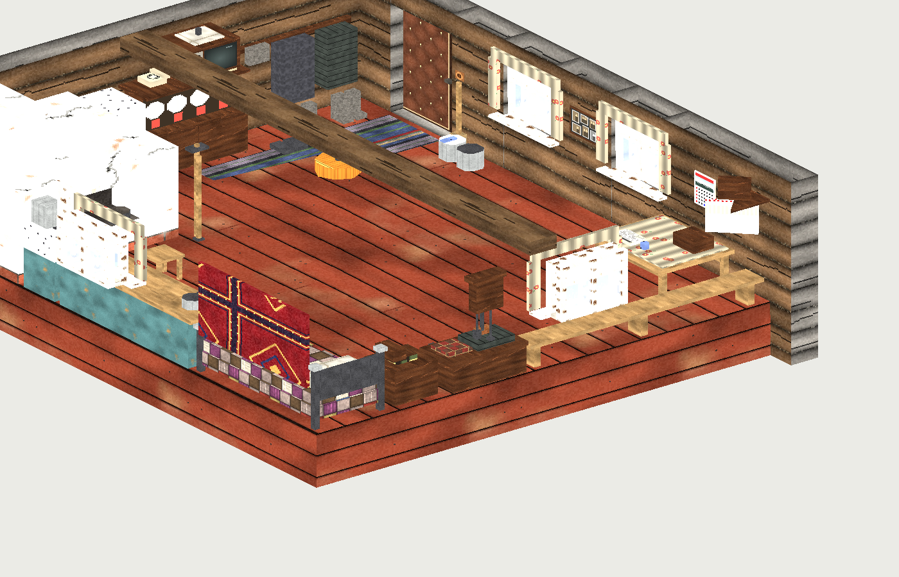

# Before the Thaw

Самостоятельная игра на движке **Xash3D FWGS** в эстетике GoldSrc-игр
1999–2001 годов. Конец 90-х, глубинка, зима, старая изба на краю деревни.

Этот этап — **стартовая локация `btt_house`**: дом в одну комнату, в котором
начинается игра. Окружение (двор, деревня, поле, лес) — следующий этап, его
география зафиксирована в [`development/docs/environment_concept.md`](development/docs/environment_concept.md).

Half-Life для работы не нужен, его ресурсы не используются. Все текстуры,
звуки и спрайты сгенерированы скриптами этого репозитория.



> Картинки в `development/docs/preview_*.png` — программный предпросмотр
> исходника карты (`development/tools/preview_map.py`): реальные текстуры,
> но условный свет. В движке свет считает RAD (лайтмапы, тени, отскоки).

## Комната

Изба в одну комнату, 320×272 юнита (≈8×7 м), потолок 96 юнитов (≈2,4 м),
бревенчатые стены, крашеный дощатый пол, матица под потолком.

| Угол / зона | Что там |
|---|---|
| СЗ | русская печь (чело, шесток, заслонка, чугунки, ухват, кочерга, топочная дверца), поленница берёзовых дров, старый холодильник |
| С, кухонный угол | рукомойник с бачком, полотенце, кухонные шкафчики со столешницей, кастрюля, чайник, таз, разделочная доска, окно (вид на лес) |
| СВ | железная кровать с лоскутным одеялом и горкой подушек, ковёр на стене, тумбочка с книгами, **радиоприёмник** |
| В | сундук, **ходики** с качающимся маятником и гирями, лавка вдоль стены, окно (вид на поле) |
| ЮВ, красный угол | **стол слева от окна** (если смотреть изнутри), **над столом календарь** (январь 2000), божница с иконой и рушником, **стул** |
| Ю, фасад | два окна с двойными рамами, ватой между рамами и занавесками, фотографии в рамке между окнами, входная дверь (обита дерматином изнутри) |
| ЮЗ, у двери | вешалка (телогрейка, пальто, шапка), валенки, калоши, два ведра с водой, веник, выключатель |
| З | сервант с посудой, телевизор-кинескоп с антенной, дисковый телефон |
| центр | лампа с оранжевым абажуром, половики, табурет |

### Интерактивность

- **Стол, стул и табурет можно двигать** (`func_pushable`): толкать — идти
  на них, тянуть — удерживать `E`.
- Выключатель у двери включает и выключает лампу с абажуром
  (именованный `light`, переключаемый стиль освещения).
- `E` на радиоприёмнике — шипение эфира, включить или выключить.
- `E` на телефоне — гудок в трубке (425 Гц, как в российской телефонной сети).
- Входная дверь заперта снаружи: если толкнуть, гремит крючок
  (`master` никогда не срабатывает; отпереть можно в следующих картах).
- Ходики тикают, маятник качается (`func_pendulum`), печь потрескивает,
  холодильник гудит, за стенами ветер (`ambient_generic`, зацикленные WAV).

### Свет

Пасмурный зимний день: `light_environment` с холодным рассеянным светом
неба через окна, слабые холодные «заполняющие» источники у каждого окна
(приём 1999 года), тёплая лампочка под абажуром и оранжевый отсвет из
печного чела. Мало источников, много мягкой темноты.

## Структура проекта

```
engine/                  бинарники Xash3D FWGS (собираются скриптом, не в git)
game/                    игровая папка (gamedir "game")
  gameinfo.txt           описание игры для Xash3D
  game.rc, default.cfg   стартовый скрипт и настройки по умолчанию
  maps/                  скомпилированные .bsp
  textures/btt_house.wad текстуры (WAD3, палитра 8 бит, 4 MIP-уровня)
  gfx/env/               скайбокс btt_overcast*.tga
  sound/                 звуки (WAV 16 бит, моно, 22050 Гц)
  sprites/               HUD-спрайт + hud.txt
  models/                (пока пусто: мебель сделана брашами, как в GoldSrc)
  dlls/, cl_dlls/        игровой код (собирается скриптом, не в git)
development/
  maps_src/btt_house.map исходник карты (Valve 220)
  textures_src/house/    исходные PNG текстур (можно рисовать поверх)
  models_src/            (пусто)
  tools/                 генераторы и проверки на Python
  docs/                  концепция окружения, превью
tools/                   скрипты сборки, компиляции и запуска (.bat и .sh)
```

## Сборка и запуск

### 1. Компилятор карт (один раз)

Используется **SDHLT** (продолжение VHLT/ZHLT, совместим с GoldSrc и Xash3D,
формат BSP v30). Скрипт скачивает исходники зафиксированной версии
(`tools/versions.txt`) и собирает их.

```bat
tools\build_tools.bat
```

```bash
tools/build_tools.sh
```

Нужны Git, CMake ≥ 3.20 и компилятор C++ (Visual Studio 2019/2022 или gcc/clang).
Можно взять и готовые бинарники SDHLT с его страницы релизов: положите
`sdHLCSG/BSP/VIS/RAD` и `sdhlt.wad` в `tools/sdhlt/` или укажите путь в
переменной `SDHLT_DIR`.

### 2. Движок и игровой код (один раз)

```bat
set SDL2_DIR=C:\libs\SDL2-2.x.x
tools\build_engine.bat
```

```bash
tools/build_engine.sh
```

Скрипт собирает Xash3D FWGS в `engine/` (параметр `--gamedir=game`) и
HLSDK-portable в `game/dlls` и `game/cl_dlls`. На Windows по умолчанию
32-битная сборка, на Linux 64-битная. Зависимости для Linux перечислены
в начале `tools/build_engine.sh`.

### 3. Компиляция карты

```bat
tools\compile.bat            rem полная компиляция
tools\compile.bat btt_house fast
```

```bash
tools/compile.sh
tools/compile.sh btt_house fast
```

Этапы: CSG (текстуры встраиваются в BSP через `-wadinclude`), BSP, VIS, RAD.
Результат — `game/maps/btt_house.bsp`, лог — `development/build/btt_house.log`.

### 4. Запуск

```bat
tools\run.bat
```

```bash
tools/run.sh -windowed -width 1280 -height 720
```

Игра стартует сразу в доме. Через меню «Новая игра» загружается та же карта
(`startmap` в `gameinfo.txt`).

Управление: WASD, мышь, `E` — использовать или тянуть, пробел — прыжок,
Ctrl — присесть, Shift — медленный шаг, `~` — консоль, F5 — скриншот.

## Редактирование карты

Откройте `development/maps_src/btt_house.map`:

- **TrenchBroom**: игра «Half-Life», формат Valve 220. Подключите
  `game/textures/btt_house.wad` и `sdhlt.wad`, FGD — `tools/sdhlt/sdhlt.fgd`
  (в нём есть `func_detail`). Всё наружное (небесная коробка, снег, забор)
  лежит в отдельном слое **Outside**, его можно скрыть.
- **J.A.C.K. / Hammer 3.5**: открываются .map Valve 220 напрямую.

Карта сначала сгенерирована скриптом `development/tools/build_house.py`,
но правильный исходник теперь сам `.map`. Если перезапустить генератор, он
**перезапишет** ручные правки.

Проверка без компилятора (выпуклость брашей, текстуры, утечки, позиция игрока):

```bash
python3 development/tools/check_map.py development/maps_src/btt_house.map --wad game/textures/btt_house.wad
```

Превью без движка:

```bash
python3 development/tools/preview_map.py development/maps_src/btt_house.map out.png --eye 200 190 65 --look 250 -8
```

## Ресурсы

Всё процедурное и пересобирается из исходников (`tools/build_assets.sh`, нужны
Python 3, Pillow и numpy):

| Скрипт | Что делает |
|---|---|
| `gen_textures.py` | 60 текстур 16–128 px (брёвна, доски, побелка, ткани, техника…) в PNG + скайбокс |
| `make_wad.py` | PNG → WAD3: палитра на каждую текстуру, 4 MIP-уровня, поддержка `{`-масок |
| `gen_sounds.py` | ветер, печь, ходики, холодильник, радиоэфир, гудок телефона, скрип двери, шаги по доскам, скрежет мебели; cue-точки для зацикливания |
| `gen_sprites.py` | HUD-спрайт SPR v2 и `hud.txt` (клиентская DLL ждёт эти имена) |
| `build_house.py` / `mapkit.py` | генерация исходной планировки в .map |

Текстуры можно перерисовывать вручную в `development/textures_src/house/*.png`
(кратно 16 px), затем запустить `python3 development/tools/make_wad.py`.

## WebAssembly

Ничего из проекта не мешает будущей сборке под Emscripten:

- в Xash3D FWGS есть платформа `emscripten`;
- игровые данные — обычные файлы в `game/` (BSP v30, WAD3, WAV, TGA, SPR),
  без нестандартной загрузки;
- текстуры встроены в BSP;
- нет нативных зависимостей сверх самого движка и HLSDK-portable;
- генераторы — чистый Python, нужны только на этапе разработки.

## Ограничения и что дальше

- **Карта ещё ни разу не компилировалась и не запускалась в движке.** В
  среде, где готовилась эта версия, сборка SDHLT и движка была недоступна.
  Геометрия проверена собственным валидатором (браши, текстуры, герметичность),
  но яркость света, лайтмапы и поведение `func_pushable` и `func_pendulum`
  нужно проверить и подстроить после первой компиляции.
- Игровой код — HLSDK-portable без изменений. Он по-прежнему пытается
  загружать модели и звуки оружия Half-Life. Их нет; по исходникам движка
  это только предупреждения в консоли, но на практике это ещё не проверено. Следующий шаг — своя ветка игрового кода без
  оружия и HEV.
- Лицензия Half-Life SDK ограничивает использование кода. Для коммерческого
  релиза нужна юридическая проверка или собственный игровой код.
- Моделей (.mdl) пока нет: вся мебель сделана брашами, как в играх 1999 года.
- Тумана (`env_fog`) нет: в HLSDK такой сущности нет.
- Персонажа и сюжетных событий нет — так задумано для этого этапа.
